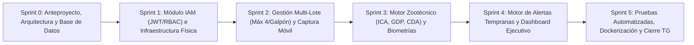

# Esquema de Tareas y Sprints para GitHub Projects — AvícolaTrack

> **Proyecto:** Sistema de Automatización Avícola para Variables Productivas (*AvícolaTrack*)  
> **Documento Base:** `construccion trabajo de grado lcrt (1).docx` y `README.md`  
> **Arquitectura:** Monolito Modular (`Spring Boot 3 / Java 21` + `Next.js 14` + `PostgreSQL 15` + `Docker Compose`)

---

## 1. Configuración Recomendada en GitHub Projects (Tablero Scrum/Kanban)

### 1.1 Columnas del Tablero (Status)
1. **📋 Product Backlog:** Todas las historias de usuario y tareas documentales pendientes de priorizar en un Sprint.
2. **🎯 Sprint Backlog (Ready):** Tareas seleccionadas y estimadas para el Sprint activo.
3. **🚧 In Progress:** Tareas en desarrollo activo (máximo 2-3 en paralelo por desarrollador).
4. **🔍 In Review / QA:** Pruebas unitarias (`mvn test`), verificación en contenedores Docker y revisión de redacción académica.
5. **✅ Done:** Funcionalidad fusionada en `main` / sección del documento aprobada.

### 1.2 Campos Personalizados (Custom Fields)
- **Sprint (Iteration):** `Sprint 0` a `Sprint 5` (duración sugerida: 2 semanas por Sprint = 12 semanas totales).
- **Story Points (Number):** Escala Fibonacci (`1`, `2`, `3`, `5`, `8`, `13`).
- **Prioridad (Single Select):** `🔥 Crítica`, `⬆️ Alta`, `➡️ Media`, `⬇️ Baja`.
- **Componente / Módulo (Single Select):** `Documentación TG`, `DevOps / DB`, `Backend - IAM`, `Backend - Infraestructura & Lotes`, `Backend - Operación & Zootecnia`, `Backend - Alertas`, `Frontend - Galponero`, `Frontend - Admin`.

### 1.3 Etiquetas de GitHub (Labels)
- `epic:documentacion` (`#0E8A16`) — Capítulos del informe final
- `epic:arquitectura-db` (`#1D76DB`) — Docker, PostgreSQL y configuración base
- `epic:iam-seguridad` (`#5319E7`) — Autenticación JWT y control de acceso por roles (`ROLE_ADMIN`, `ROLE_GALPONERO`)
- `epic:infraestructura-lotes` (`#FBCA04`) — Granjas, Galpones y regla de máximo 4 lotes activos por galpón
- `epic:operacion-zootecnia` (`#D93F0B`) — Captura diaria (agua, alimento, mortalidad), biometrías y cálculo de $ICA$, $GDP$, $CDA$
- `epic:motor-alertas` (`#B60205`) — Evaluación automática de umbrales críticos y bandeja de alertas
- `type:feature` / `type:test` / `type:docs`

---

## 2. Mapa de Ruta y Flujo de Sprints

---

## 3. Desglose Detallado de Sprints, Historias de Usuario y Tareas (Issues)

### 🏁 Sprint 0: Fundamentación Documental, Arquitectura y Persistencia
**Objetivo del Sprint:** Estructurar la base investigativa del Trabajo de Grado y levantar el entorno base del Monolito Modular con el esquema relacional en PostgreSQL.

| ID Issue | Tipo | Título de la Tarea / Historia de Usuario | Módulo / Archivo Relacionado | Prioridad | Pts |
| :--- | :--- | :--- | :--- | :--- | :---: |
| **TG-01** | `docs` | Redactar Problema de Investigación, Planteamiento, Formulación, Objetivos y Justificación/Delimitación | `construccion trabajo de grado lcrt (1).docx` | 🔥 Crítica | 5 |
| **TG-02** | `docs` | Desarrollar Marco Teórico, Antecedentes, Teorías Generales, Hipótesis y Metodología de Desarrollo | `construccion trabajo de grado lcrt (1).docx` | ⬆️ Alta | 5 |
| **ARQ-01** | `feature` | Inicializar monorepo con estructura de Monolito Modular en Spring Boot 3 (Java 21) y Next.js 14 | `backend-monolith/pom.xml`, `frontend-nextjs/package.json` | 🔥 Crítica | 3 |
| **DB-01** | `feature` | Diseñar e implementar el script DDL de base de datos relacional (6 tablas + restricciones + índices) | `backend-monolith/src/main/resources/db/migration/V1__init_schema.sql` | 🔥 Crítica | 5 |
| **OPS-01** | `feature` | Configurar variables de entorno y orquestación inicial de PostgreSQL 15 en Docker | `docker-compose.yml`, `.env.example` | ⬆️ Alta | 2 |

---

### 🔐 Sprint 1: Seguridad RBAC (IAM) e Infraestructura Avícola
**Objetivo del Sprint:** Implementar autenticación sin estado mediante JWT con diferenciación de roles (`ROLE_ADMIN` y `ROLE_GALPONERO`) y habilitar la administración de Granjas y Galpones.

| ID Issue | Tipo | Título de la Tarea / Historia de Usuario | Módulo / Archivo Relacionado | Prioridad | Pts |
| :--- | :--- | :--- | :--- | :--- | :---: |
| **HU-01** | `feature` | **Como** usuario del sistema, **quiero** iniciar sesión con correo y contraseña **para** acceder a las vistas según mi rol (`ROLE_ADMIN` o `ROLE_GALPONERO`) | `AuthController.java`, `UserService.java` | 🔥 Crítica | 5 |
| **IAM-01** | `feature` | Configurar filtros de seguridad JWT, CORS y protección de endpoints por rol en Spring Security | `SecurityConfig.java`, `JwtTokenProvider.java` | 🔥 Crítica | 5 |
| **FE-01** | `feature` | Construir pantalla de Login con redirección automática según rol (Admin → Dashboard / Galponero → Registro Táctil) | `frontend-nextjs/src/app/login/page.tsx`, `api.ts` | 🔥 Crítica | 3 |
| **HU-02** | `feature` | **Como** Administrador, **quiero** registrar y consultar granjas y galpones con su capacidad máxima de aves **para** estructurar la planta avícola | `Granja.java`, `Galpon.java` | ⬆️ Alta | 5 |
| **SEED-01** | `feature` | Implementar semilla automática (`DataInitializer`) con *Granja Avícola El Porvenir* y usuarios piloto | `DataInitializer.java` | ➡️ Media | 2 |

---

### 🐣 Sprint 2: Gestión Multi-Lote (Regla de 4 Cuadrantes) y Captura Móvil de Campo
**Objetivo del Sprint:** Garantizar la regla de negocio de máximo 4 lotes activos por galpón y proveer al galponero una interfaz móvil táctil para el registro diario de mortalidad, agua y alimento con descuento atómico de población viva.

| ID Issue | Tipo | Título de la Tarea / Historia de Usuario | Módulo / Archivo Relacionado | Prioridad | Pts |
| :--- | :--- | :--- | :--- | :--- | :---: |
| **HU-03** | `feature` | **Como** Administrador, **quiero** encasetar lotes asignando su cuadrante (1 a 4) dentro de un galpón **para** llevar trazabilidad independiente sin exceder 4 lotes activos por galpón | `LoteService.java`, `Lote.java` | 🔥 Crítica | 5 |
| **FE-02** | `feature` | Desarrollar vista administrativa de gestión de Galpones y apertura/cierre de Lotes | `frontend-nextjs/src/app/admin/galpones/page.tsx` | ⬆️ Alta | 5 |
| **HU-04** | `feature` | **Como** Galponero, **quiero** registrar diariamente las bajas, alimento suministrado (kg) y agua consumida (L) de cada lote **para** actualizar la población viva de forma transaccional (ACID) | `RegistroOperativoService.java`, `RegistroDiario.java` | 🔥 Crítica | 8 |
| **FE-03** | `feature` | Construir interfaz móvil táctil para el Galponero con selector rápido de cuadrantes (Lotes 1 al 4) y validación de campos | `frontend-nextjs/src/app/galponero/registro/page.tsx` | 🔥 Crítica | 5 |

---

### 📊 Sprint 3: Biometrías y Motor de Cálculo Zootécnico ($ICA$, $GDP$, $CDA$)
**Objetivo del Sprint:** Automatizar el registro de pesajes muestrales y programar las ecuaciones matemáticas zootécnicas estandarizadas.

| ID Issue | Tipo | Título de la Tarea / Historia de Usuario | Módulo / Archivo Relacionado | Prioridad | Pts |
| :--- | :--- | :--- | :--- | :--- | :---: |
| **HU-05** | `feature` | **Como** Galponero/Admin, **quiero** registrar biometrías de peso promedio y tamaño de muestra **para** calcular la ganancia diaria de peso ($GDP$) del lote | `BiometriaPeso.java`, `RegistroOperativoService.java` | ⬆️ Alta | 5 |
| **HU-06** | `feature` | **Como** Sistema, **quiero** calcular automáticamente $CDA$, Tasa de Mortalidad Diaria, $GDP$ e Índice de Conversión Alimenticia ($ICA$) **para** eliminar errores de cálculo manual | `CalculoZootecnicoService.java` | 🔥 Crítica | 8 |
| **FE-04** | `feature` | Implementar vista de Reportes y Analítica Zootécnica con historial de indicadores por lote | `frontend-nextjs/src/app/admin/reportes/page.tsx` | ⬆️ Alta | 5 |

---

### 🚨 Sprint 4: Motor de Inferencia de Alertas Tempranas y Dashboard Ejecutivo
**Objetivo del Sprint:** Evaluar en tiempo real cada captura operativa frente a los umbrales sanitarios y productivos para disparar alertas tempranas y visualizarlas en el panel directivo.

| ID Issue | Tipo | Título de la Tarea / Historia de Usuario | Módulo / Archivo Relacionado | Prioridad | Pts |
| :--- | :--- | :--- | :--- | :--- | :---: |
| **HU-07** | `feature` | **Como** Sistema, **quiero** disparar alertas críticas si la mortalidad diaria $\ge 0.50\%$, el consumo de agua cae $> 20\%$, la relación agua/alimento sale del rango $[1.4, 2.6]$ L/kg o el $ICA > 1.80$ en semana 5 **para** prevenir pérdidas productivas | `AlertEngineService.java`, `AlertaLote.java` | 🔥 Crítica | 8 |
| **HU-08** | `feature` | **Como** Administrador, **quiero** gestionar la bandeja de alertas tempranas y marcarlas como revisadas **para** auditar las novedades sanitarias de cada galpón | `frontend-nextjs/src/app/admin/alertas/page.tsx` | ⬆️ Alta | 5 |
| **HU-09** | `feature` | **Como** Administrador, **quiero** visualizar un Dashboard Ejecutivo con KPIs consolidados de aves vivas, lotes activos, mortalidad e $ICA$ **para** tomar decisiones gerenciales | `frontend-nextjs/src/app/admin/dashboard/page.tsx` | ⬆️ Alta | 5 |

---

### 🧪 Sprint 5: Aseguramiento de Calidad (QA), Contenedorización Final e Informe de Grado
**Objetivo del Sprint:** Certificar mediante pruebas unitarias automatizadas los módulos críticos, empaquetar toda la solución en Docker Compose y consolidar los resultados, conclusiones y repositorio en el documento de grado.

| ID Issue | Tipo | Título de la Tarea / Historia de Usuario | Módulo / Archivo Relacionado | Prioridad | Pts |
| :--- | :--- | :--- | :--- | :--- | :---: |
| **QA-01** | `test` | Implementar suite de pruebas unitarias para fórmulas zootécnicas (`CalculoZootecnicoServiceTest` - 4 tests) | `CalculoZootecnicoServiceTest.java` | 🔥 Crítica | 3 |
| **QA-02** | `test` | Implementar pruebas unitarias del motor de alertas (`AlertEngineServiceTest`) y restricción de 5to lote (`LoteServiceTest`) | `AlertEngineServiceTest.java`, `LoteServiceTest.java` | 🔥 Crítica | 5 |
| **OPS-02** | `feature` | Empaquetar `Dockerfile` multi-etapa para Backend y Frontend y validar despliegue con `docker compose up --build` | `backend-monolith/Dockerfile`, `frontend-nextjs/Dockerfile` | ⬆️ Alta | 3 |
| **TG-03** | `docs` | Redactar capítulos finales: Resultados de la Investigación, Repositorio Producto Software, Conclusiones, Recomendaciones y Anexos | `construccion trabajo de grado lcrt (1).docx`, `README.md` | 🔥 Crítica | 8 |

---

## 4. Resumen de Métricas del Proyecto

| Sprint | Enfoque Principal | Issues / Tareas | Story Points | Entregable Verificable (Hito / Milestone) |
| :--- | :--- | :---: | :---: | :--- |
| **Sprint 0** | Anteproyecto, Arquitectura y Esquema DDL | 5 | 20 pts | Documento Cap. 1-2 + Esquema PostgreSQL (`V1__init_schema.sql`) |
| **Sprint 1** | Seguridad JWT/RBAC e Infraestructura Física | 5 | 20 pts | Login multi-rol funcional + CRUD Granjas/Galpones |
| **Sprint 2** | Regla Multi-Lote (4/Galpón) y Captura Móvil | 4 | 23 pts | Apertura de Lotes + Interfaz táctil de Galponero transaccional |
| **Sprint 3** | Motor Zootécnico ($ICA$, $GDP$, $CDA$) y Biometrías | 3 | 18 pts | Motor matemático zootécnico y vista de reportes históricos |
| **Sprint 4** | Motor de Alertas Tempranas y Dashboard | 3 | 18 pts | Inferencia automática de alertas + Dashboard Ejecutivo |
| **Sprint 5** | Pruebas Unitarias, Docker y Cierre Tesis | 4 | 19 pts | 7/7 tests en verde + `docker-compose` + Informe Final completo |
| **TOTAL** | **6 Sprints (12 Semanas)** | **24 Issues** | **118 pts** | **Sistema AvícolaTrack + Trabajo de Grado Finalizado** |
